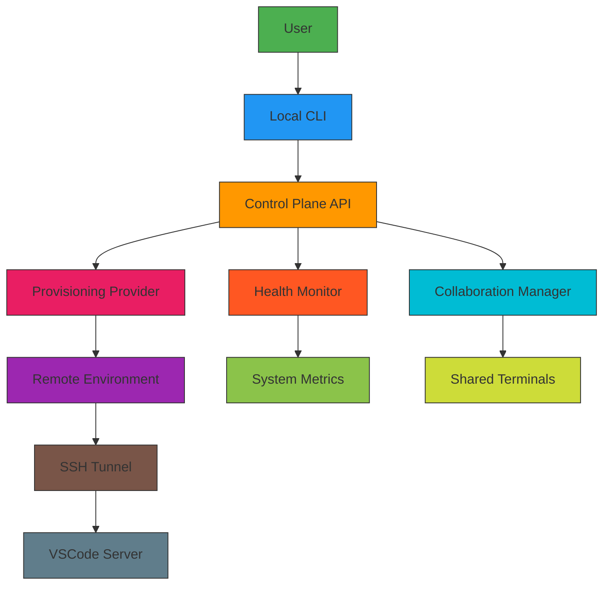

# System Architecture

## Overview

This document describes the architecture of the remote control plane and local CLI system for autonomous coding agents.

## Components

### Control Plane
The control plane is the central management system that:
- Manages remote development environments
- Handles API requests from the CLI
- Authenticates users via API tokens
- Orchestrates environment provisioning
- Monitors system health and resources

### Local CLI
The local CLI provides command-line interface for:
- Creating and managing remote environments
- Connecting to remote development environments
- Managing collaboration sessions
- Viewing health status and system metrics

### Provisioning Providers
Multiple provisioning providers can be supported:
- **Ansible**: Initial implementation for environment provisioning
- **Other Providers**: Extensible architecture for additional providers

### Isolation Layer
Hybrid isolation approach combining:
- **Containers**: For lightweight application isolation
- **Virtual Machines**: For stronger security boundaries
- **Network Isolation**: Separate network namespaces for environments

### Collaboration System
Enables collaborative development with:
- Shared terminals for multiple users
- Session management and synchronization
- Real-time communication channels

### Health Monitoring
Basic health checks for:
- CPU and memory usage
- Disk space availability
- Service status monitoring
- Resource utilization tracking

## Data Flow

1. User interacts with local CLI
2. CLI sends API requests to control plane
3. Control plane authenticates and validates requests
4. Control plane provisions or manages remote environment
5. Environment is accessible via SSH tunnel
6. Collaboration sessions are established
7. Health checks monitor system status

## Architecture Diagram

